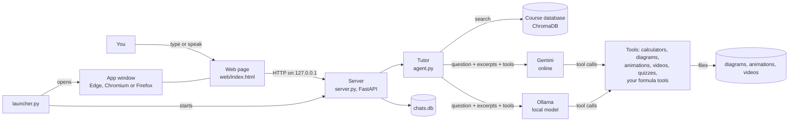

# RouSanGPT - Computer Networks and Cryptography AI Teaching Assistant

<p align="center"></p>

Course project for **NES 312 Computer Networks** (Instructor: Dr. Rousan).
Author: AbdulAzez Sawalma

RouSanGPT is an AI teaching assistant for Computer Networks and for Cryptography and
Network Security. It answers from your course materials (slides, books, homework),
calculates networking and cryptography problems exactly,
draws diagrams, plays animations, makes narrated videos, runs quizzes, and
understands voice questions in English and Arabic. It runs as a desktop app on
**Linux** and **Windows**, as a web app in the browser, or in the terminal, and it
is built only with free tools.

---

## Contents
1. [Features](#features)
2. [Which way should I run it?](#which-way-should-i-run-it)
3. [Running on Linux](#running-on-linux)
4. [Running on Windows](#running-on-windows)
5. [Dev mode (from the source code)](#dev-mode-from-the-source-code)
6. [Using the app](#using-the-app)
7. [How it works](#how-it-works)
8. [Project structure](#project-structure)
9. [Tests](#tests)
10. [Privacy and security](#privacy-and-security)
11. [Known limitations](#known-limitations)

---

## Features
- **A tutor that knows the course:** answers from the lecture slides, textbooks
  and homework files (retrieval-augmented generation with a local ChromaDB search
  database) and shows which slide or page it used.
- **Exact calculators:** subnetting (CIDR), transmission and propagation delays,
  bandwidth-delay product, CRC, Internet checksum, Dijkstra's shortest paths and a
  safe general calculator, so the AI never guesses numbers.
- **Cryptography solvers:** number theory (Euclid and extended Euclid tables,
  modular inverse, fast modular powers with Fermat/Euler, Euler's totient, prime
  factors, Miller-Rabin, Chinese Remainder Theorem, linear congruences, primitive
  roots, discrete logarithms, Zn tables), finite fields (polynomial arithmetic
  over GF(p), irreducibility, polynomial GCD, GF(2^n) multiply and inverse, AES's
  GF(2^8) by default), classical ciphers (Caesar with brute force, affine,
  monoalphabetic, frequency analysis, Vigenere and autokey, Playfair, Hill,
  Vernam / one-time pad, rail fence, row transposition) and block cipher sizes and
  brute-force times. Each one shows its working in the same table form the
  slides use.
- **Your own formula tools:** describe a formula in plain English or Arabic and the
  AI fills in a tool for you; the tutor then uses it in its answers.
- **The slides' figures, with calculated numbers ("explainers"):** 31 kinds of
  pictures, each also as an animation that builds step by step, made after the
  lecture slides. Networks: encapsulation, packet vs circuit switching, HTTP
  response time, stop-and-wait vs pipelining, Go-Back-N and Selective Repeat in
  action, TCP RTT estimation and congestion window (Reno and Tahoe), Internet
  checksum, CRC division, longest prefix matching, IP fragmentation, address bits,
  Dijkstra's table, distance vectors, switch self-learning and ALOHA. Crypto: GCD,
  extended Euclid, inverses, square-and-multiply, Miller-Rabin, CRT, GF(2^n)
  multiply and inverse, and the Caesar, Vigenere, Playfair, rail fence,
  transposition and Vernam ciphers. With no numbers given, each one shows the
  slides' own example; every number is calculated, never typed by the AI.
- **Diagrams:** message-sequence diagrams (TCP handshake, DNS, HTTP...), network
  topologies, flowcharts and packet headers (TCP, UDP, IP).
- **Device icons everywhere:** 34 icons (PC, laptop, server, web, DNS and mail
  servers, database, data center, router, switch, hub, firewall, modem, access
  point, cell tower, satellite, cloud, phone, tablet, printer, camera, TV, Alice and
  Bob, Trudy the attacker, key, lock, shield, document, envelope, certificate
  authority, globe, home, building, gear), chosen from each device's name, in
  topologies, sequence diagrams, every animation and the explainers.
- **Four looks (Settings > Look),** each for the whole app (the page and its
  icons, device icons, pictures, diagrams, animations and video slides), in the
  light and the dark theme:
  - *Frutiger Aero* (the default): glass panels over a sky, glossy buttons,
    bubbles and icons.
  - *Classic*: flat.
  - *Cybercore*: neon on near-black, a grid and scanlines, HUD panels with cut
    corners, glitch titles, a monospace font and glowing neon icons.
  - *Y2K*: holographic pastels with sparkles, chrome pill buttons, candy bubbles,
    rainbow headings and candy icons.
  Pictures, animations and videos already made can be redrawn in the chosen look
  (Settings > Look > Redraw): each keeps a small recipe (`.recipe.json`) next to
  it, and videos are made again from their saved script.
- **Math that looks like math:** 2^k * q is shown with a raised k and a
  multiplication dot, a^(q*2^j) with a raised q·2^j, x_i with a lowered i, -> as an
  arrow, in the answers and in the pictures; read-aloud says "2 to the power k
  times q".
- **Friendly answers:** the tutor uses a few fitting emojis (💡 tips, ⚠️ common
  mistakes, ✅ correct, 🔐 encryption...); read-aloud skips them.
- **Animations:** message exchanges, store-and-forward packet flow, sliding window
  and Dijkstra's algorithm, plus every explainer above, as short MP4 clips.
- **Narrated videos:** educational MP4 videos made of slides, diagrams and
  animations with a spoken explanation.
- **Quizzes:** multiple-choice, fill-in-the-blank and Wireshark-style packet
  analysis questions, built from the course materials.
- **Voice:** ask by speaking (English or Arabic) and listen to any answer read
  aloud (a Jordanian voice for Arabic).
- **Two AIs:** Google Gemini (online, free API key) or a local model with Ollama
  (offline, on your own computer), with automatic fallback.
- **Academic integrity:** homework problems switch the tutor to "hint mode" (hints
  and similar practice problems instead of final answers), and answer keys are
  hidden from the tutor.
- **A modern app:** saved chats with search, light and dark theme, course-material
  manager, settings panel, first-run setup, and it also works in a phone-sized
  window.

---

## Which way should I run it?

| You want to... | Use | Section |
|---|---|---|
| Use it like a normal app on Linux (menu icon, own window) | the Linux app | [Running on Linux](#running-on-linux) |
| Use it like a normal app on Windows (Start menu, own window) | the Windows app | [Running on Windows](#running-on-windows) |
| Work on the code, or run it from the project folder | dev mode | [Dev mode](#dev-mode-from-the-source-code) |

All three run the same program. The apps keep your data in a separate folder; dev
mode keeps it in the project folder.

**What you need in every case**
- A free **Gemini API key** from https://aistudio.google.com/apikey (sign in with a
  Google account and press "Create API key"). The app asks for it on the first run.
  Without a key you can still use the local model.
- An **internet connection** for Gemini, voice input and read-aloud. The first
  start also downloads the search model (about 80 MB) once (the Windows setup
  already contains it).
- Your **course files** (PDF, PPTX, PPT or TXT). They are not part of this
  repository; you add them in the app.

---

## Running on Linux

### 1. Install
```bash
git clone https://github.com/its-ezover/RouSanGPT.git
cd RouSanGPT
./install.sh
```
The installer needs **no sudo**. It:
1. checks the programs RouSanGPT uses and prints the install command for Arch,
   Debian/Ubuntu and Fedora for anything that is missing:

   | Program | Needed for | Arch | Debian/Ubuntu | Fedora |
   |---|---|---|---|---|
   | Python 3.10+ (with venv) | everything | `python` | `python3 python3-venv` | `python3` |
   | FFmpeg | videos, animations, voice input | `ffmpeg` | `ffmpeg` | `ffmpeg` |
   | Graphviz | topology diagrams | `graphviz` | `graphviz` | `graphviz` |
   | LibreOffice or catdoc (optional) | old `.ppt` files | `libreoffice-fresh` | `libreoffice-impress` | `libreoffice-impress` |
   | Chromium-based browser (optional) | the most app-like window | `chromium` | `chromium-browser` | `chromium` |
   | Ollama (optional) | the offline local model | `ollama` | see ollama.com | see ollama.com |

2. copies the program to `~/.local/share/RouSanGPT/app` and installs the Python
   packages in their own environment (`~/.local/share/RouSanGPT/venv`). The first
   time this takes a few minutes;
3. adds **RouSanGPT** to your app menu (Education) with its icon, and creates the
   command `~/.local/bin/rousangpt`.

**Already used RouSanGPT from a folder?** Bring your chats, course database,
formula tools and videos into the app:
```bash
./install.sh --import-data ~/path/to/old/RouSanGPT
```
It also offers to copy the Gemini API key from that folder's `.env` file.

### 2. Start it
Click **RouSanGPT** in the app menu (or run `rousangpt`). The window opens after a
few seconds:
- with a Chromium-based browser installed (Chromium, Chrome, Brave, Edge, Vivaldi)
  it opens as an app window;
- otherwise it uses Firefox with its own profile that has no tabs or address bar;
- if neither is installed, it opens in your default browser.

The first time, the **setup screen** asks for your Gemini API key. It is tested
with Google and stored only on your computer. Then add your course files: drag
them (or a whole folder) onto the window, or open **Materials** and choose them.

### 3. Close it
Just close the window: RouSanGPT stops by itself. **Settings > Quit RouSanGPT**
stops it at once. Clicking the icon again while it is open opens another window to
the same app (it never runs twice).

### Update and uninstall
```bash
cd RouSanGPT && git pull && ./install.sh     # update; your data is kept
./uninstall.sh                               # remove the app; your data is kept
./uninstall.sh --purge                       # also delete your data (asks first)
```

### Where things are
| What | Where |
|---|---|
| Your data: chats, course database, materials, videos, settings, API key | `~/.local/share/RouSanGPT/data` (or `$XDG_DATA_HOME/RouSanGPT/data`) |
| Log file | `~/.local/share/RouSanGPT/data/logs/rousangpt.log` |
| Program and Python packages | `~/.local/share/RouSanGPT/app` and `~/.local/share/RouSanGPT/venv` |
| Command and menu entry | `~/.local/bin/rousangpt`, `~/.local/share/applications/rousangpt.desktop` |

### Troubleshooting (Linux)
- **Nothing happens when clicking the icon:** run `~/.local/bin/rousangpt --console`
  in a terminal to see the messages, or read the log file.
- **It opens as a normal browser tab:** install Chromium (`sudo pacman -S chromium`)
  or Firefox.
- **Microphone:** allow it when the window asks, and check that it works in your
  system sound settings.
- **Videos, animations or voice input fail:** install FFmpeg.
- **Topology diagrams fail:** install Graphviz.
- **Local model:** see [Gemini or local model](#gemini-or-local-model). On Arch,
  the `ollama` package runs a system service with its models in `/var/lib/ollama`,
  while a manually started `ollama serve` uses `~/.ollama`. The Settings panel shows
  which one is in use.

---

## Running on Windows

### 1. Install
1. Download **[RouSanGPT-Setup.exe](https://github.com/its-ezover/RouSanGPT/releases/latest/download/RouSanGPT-Setup.exe)**
   (from the [Releases page](https://github.com/its-ezover/RouSanGPT/releases)).
2. Open it and press **Next** until it finishes.

If Windows shows "Windows protected your PC", press **More info > Run anyway** (the
setup is not signed with a paid certificate).

The setup needs **no administrator rights** and **nothing else installed**: it
contains its own Python with every package, FFmpeg (videos, animations, voice
input), Graphviz (diagrams), the Microsoft Visual C++ runtime the packages need, and
the course-search model. It installs the program to
`%LOCALAPPDATA%\Programs\RouSanGPT`, adds **RouSanGPT** to the Start menu (and to
the desktop if you tick the box), and lists it in **Settings > Apps**.

Optional extras you can install yourself: [LibreOffice](https://www.libreoffice.org/)
for old `.ppt` files, and [Ollama](https://ollama.com/download) for the offline
local model.

Silent install (for labs): `RouSanGPT-Setup.exe /VERYSILENT /TASKS=desktopicon`.

### 2. Start it
Open **RouSanGPT** from the Start menu (type "RouSanGPT"). It opens in its own
**Microsoft Edge app window** (Chrome, Brave or Firefox if Edge is missing), with
no black console window. The first time, the setup screen asks for your Gemini API
key; then add your course files in **Materials**.

### 3. Close it
Close the window and RouSanGPT stops by itself, or use **Settings > Quit RouSanGPT**.

### Update and uninstall
- **Update:** download the new `RouSanGPT-Setup.exe` and open it. If RouSanGPT is
  running, the setup closes it first. Your data is kept.
- **Uninstall:** **Settings > Apps > RouSanGPT > Uninstall**. It then asks whether
  to delete your data too (the answer is "No" unless you choose "Yes").
- **Coming from the old `install.cmd` version:** just run the setup. It removes
  the old program and keeps your chats, course files and API key.

### Where things are
| What | Where |
|---|---|
| Your data: chats, course database, materials, videos, settings, API key | `%LOCALAPPDATA%\RouSanGPT\data` |
| Log file | `%LOCALAPPDATA%\RouSanGPT\data\logs\rousangpt.log` |
| Program (with its Python, FFmpeg and Graphviz) | `%LOCALAPPDATA%\Programs\RouSanGPT` |

### Troubleshooting (Windows)
- **Nothing happens when opening the app:** run
  `%LOCALAPPDATA%\Programs\RouSanGPT\rousangpt-console.cmd` to see the messages, or
  read the log file.
- **Microphone:** allow it when Edge asks, and turn on Settings > Privacy & security
  > Microphone > "Let desktop apps access your microphone".
- **Local model:** install Ollama from https://ollama.com/download. The Ollama app
  keeps its models in `%USERPROFILE%\.ollama\models`.

### Building the setup
GitHub Actions builds `RouSanGPT-Setup.exe` for every change (download it from the
run's **Artifacts**), and publishes it on the Releases page when a version tag is
pushed (`git tag v1.2.0 && git push origin v1.2.0`). To build it on a Windows
computer: install [Inno Setup 6](https://jrsoftware.org/isdl.php) and Python 3.13,
then run `pwsh windows\build.ps1`; the result is `dist\RouSanGPT-Setup.exe`.

---

## Dev mode (from the source code)
Use this to work on the code, or to run RouSanGPT straight from the project folder.
In dev mode all data (chats, `course_db`, media, settings) lives in the project
folder, and the API key can come from a `.env` file.

### Linux
```bash
git clone https://github.com/its-ezover/RouSanGPT.git
cd RouSanGPT
python -m venv venv
source venv/bin/activate          # fish: source venv/bin/activate.fish
pip install -r requirements.txt
cp .env.example .env              # then paste your Gemini API key into .env
sudo pacman -S ffmpeg graphviz portaudio catdoc   # Arch names
```
(`portaudio` is only needed for the terminal app's microphone.)

### Windows
```bat
git clone https://github.com/its-ezover/RouSanGPT.git
cd RouSanGPT
py -3.12 -m venv venv
venv\Scripts\activate
pip install -r requirements.txt
copy .env.example .env
winget install -e --id Gyan.FFmpeg --source winget
winget install -e --id Graphviz.Graphviz --source winget
```
Then paste your Gemini API key into `.env`. On Windows, start Python with
`-X utf8` (for example `python -X utf8 server.py`) so Arabic text is always read and
written correctly.

### Course files
Either add them in the app (drag files or folders onto the window, or use
**Materials**), or put them in a folder named
`materials` and build the search database in one go (takes a few minutes):
```bash
python ingest.py
```

### Start it (three ways)
```bash
python server.py      # web app in your browser at http://127.0.0.1:8000 (Ctrl+C stops it)
python launcher.py    # the desktop app window, using this folder for data
python chat.py        # terminal app
```

---

## Using the app
- **Ask anything** about Computer Networks, in English or Arabic, by typing or with
  the **microphone** button. Enter sends, Shift+Enter starts a new line.
- **Ask for pictures and media:** "Draw the TCP three-way handshake", "Draw the IP
  header", "Show me an animation of Dijkstra's algorithm on A-B 2, A-C 5, B-C 1",
  "Make a video explaining how DNS works". They appear inside the chat.
- **Practice:** "Quiz me on subnetting with 3 questions", then answer in the chat.
- **Calculations:** "Split 192.168.1.0/24 into 4 subnets", "What is the
  transmission delay of a 1500 byte packet on 10 Mbps?". The answer shows which
  tools were used.
- **Under each answer:** which AI answered, which tools were used, the course
  sources that were searched, **Listen** (read aloud) and **Copy**.
- **Top bar:** choose the AI (Auto, Gemini, Local model) and switch between light
  and dark. Next to the message box: the language (Auto, English, Arabic).
- **Sidebar:** your saved chats (search, rename, delete), **Materials** (add or
  remove course files), **Tools** (your formula tools) and **Settings**.
- **Adding course files:** drop PDF, PPTX, PPT or TXT files, or a folder of them,
  anywhere on the window (or on the drop zone in **Materials**). Each file shows
  its progress; other kinds of files are skipped with a note. You can close the
  panel and keep chatting: the line above the message box says when they are added.
- While an answer is being prepared, the other chats are grayed out; you can switch
  chats again when it is done.
- In the terminal app (`python chat.py`): type a question, `/voice` to speak,
  `/paste` for several lines, `quit` to exit.

---

## How it works

### The big picture

Everything runs on your own computer. The only things that leave it are the
requests to Gemini (questions, course excerpts, voice recordings) and the text sent
to Microsoft's free read-aloud service. The server only listens on `127.0.0.1`, so
other computers on the network cannot reach it.

### What happens when you ask a question
1. **The page** sends your message, the chosen language and the chosen AI to
   `POST /api/chat`. The server starts the work in the background and returns a
   job number at once, so long jobs (a video can take minutes) never time out.
   The page asks `GET /api/result/<job>` every 2 seconds and shows "Thinking...".
2. **The tutor** (`agent.Session.ask`) searches the course database for the most
   relevant excerpts (see below) and builds the prompt: the excerpts, your message
   and a language note ("reply in English only", "reply in Jordanian Arabic"...).
   If nothing matches, or no course files were added yet, it tells the AI to answer
   from general knowledge and to say so.
3. **The AI answers** following the tutor's instructions (`TUTOR_PERSONALITY` in
   `agent.py`: friendly, simple, hint mode for homework, always use tools for
   calculations and pictures). The AI does not calculate or draw by itself: it
   **calls tools**, which are normal Python functions. The Gemini SDK runs them
   automatically and gives the results back to the AI; for the local model the
   tutor runs this loop itself (up to 6 rounds).
4. **Media:** tools that make a picture or a video save it in `diagrams/`,
   `animations/` or `videos/`. The tutor collects those files and the page shows
   them inside the answer (served from `/files/...`).
5. **Saving:** the question, answer, tools used, sources and media are saved in
   `chats.db` (SQLite). The first answer also gives the chat its title.
6. **The page** shows the answer (simple Markdown), the media, "Answered by",
   "Tools used", the sources, and the Listen and Copy buttons.

### Course knowledge (retrieval-augmented generation)
- **Adding a file** (drag and drop or the Materials panel, or `ingest.py`): `ingest_lib.py` reads the
  text page by page (PDF with pypdf), slide by slide (PPTX with python-pptx; old
  PPT through LibreOffice or catppt) or a few lines at a time (TXT). The text is cut
  into pieces of 800 characters that overlap by 150, so no idea is cut in half.
  Each piece is stored in ChromaDB (`course_db/`) with its file name and location
  ("slide 12", "page 157").
- **Embeddings:** ChromaDB turns every piece into a vector with a small local model
  (all-MiniLM-L6-v2, downloaded once). Searching compares vectors, so it finds
  pieces with the same meaning even when the words differ.
- **The kind of file comes from its name:** `.ppt`/`.pptx` files are lecture
  slides; names with "solution" or "answer" are **answer keys** and are never
  searched; names with "hw", "homework" or "question" are homework; everything else
  counts as books and other notes.
- **Fair search:** every question gets up to 3 slide pieces, 2 homework pieces and
  3 book pieces, so one big textbook cannot crowd out the slides. The sources are
  shown under the answer.

### The tools
| Group | Tools |
|---|---|
| Subnetting and delays (`tools.py`) | `subnet_info`, `split_into_subnets`, `delay_calculation`, `bandwidth_delay_product` |
| Error detection and routing (`more_tools.py`) | `crc_calculate`, `crc_check`, `dijkstra_shortest_paths` |
| Checksums and arithmetic (`extra_tools.py`) | `internet_checksum_calculate`, `internet_checksum_verify`, `calculator` (safe, no code execution) |
| Number theory (`number_theory_tools.py`) | `gcd_euclid`, `extended_euclid`, `modular_inverse`, `modular_power`, `euler_totient`, `prime_factorization`, `miller_rabin_test`, `chinese_remainder`, `solve_linear_congruence`, `primitive_roots`, `discrete_logarithm`, `modular_tables` |
| Finite fields (`finite_field_tools.py`) | `polynomial_arithmetic` (add, subtract, multiply, divide, gcd, factor over GF(p) or ordinary), `gf2n_arithmetic` (add, multiply, inverse, divide in GF(2^n)) |
| Classical and block ciphers (`cipher_tools.py`) | `caesar_cipher`, `affine_cipher`, `monoalphabetic_cipher`, `letter_frequency`, `vigenere_cipher`, `playfair_cipher`, `hill_cipher`, `vernam_xor`, `rail_fence_cipher`, `row_transposition_cipher`, `block_cipher_sizes`, `brute_force_time` |
| Diagrams (`diagram_tools.py`) | `draw_topology` (Graphviz), `draw_sequence_diagram` and `draw_packet_header` (matplotlib) |
| Animations (`animation_tools.py`) | `animate_message_exchange`, `animate_packet_flow`, `animate_sliding_window`, `animate_dijkstra` |
| The slides' figures (`explainers.py`) | `draw_explainer` and `animate_explainer`: one tool each for all 31 kinds (from `net_visuals.py` and `crypto_visuals.py`), so the request to the AI stays small |
| Videos (`video_tools.py`) | `create_video` |
| Quizzes (`quiz.py`) | `create_quiz`, `check_quiz_answer` |
| Your formula tools (`formula_tools.py`) | whatever you create in the Tools panel |

**Formula tools** let anyone add a calculator without programming. In the Tools
panel you pick an example, write the formula yourself, or describe the calculation
and press "Fill the form with AI" (Gemini returns a structured draft: name,
description, inputs with units and example values, and the formula). The inputs
are found automatically in the formula, and the result with the example values is
shown live while you type. Formulas are checked by a small safe evaluator (only
numbers, input names, `+ - * / // % **`, brackets and functions such as `sqrt`,
`log2` and `ceil`), never by running Python code. Saved tools live in
`formula_tools.json` and become real tools for the AI straight away.

### Hint mode (academic integrity)
The tutor switches to hint mode when the student says a problem is homework, an
assignment, graded work, a quiz or an exam, or pastes a problem that matches a
homework file or a textbook end-of-chapter problem. In hint mode it gives one idea
and one hint per message, checks the student's own attempts (with the tools), and
offers a similar practice problem with different numbers that it may solve fully,
but it never gives the final answer to the homework itself, even when asked
repeatedly. Answer keys and solution manuals are hidden from the search, so the
tutor cannot leak them.

### Diagrams, animations and videos
- **Diagrams:** network layouts are written by the AI in Graphviz's DOT language and
  drawn by Graphviz (`dot`); sequence diagrams and packet headers are drawn with
  matplotlib. All are PNG files in `diagrams/`.
- **Animations:** Pillow draws every frame (30 per second) and FFmpeg turns the
  frames into an MP4 in `animations/`. The AI chooses the content (for example the
  graph for Dijkstra) and then explains what the student sees.
- **Explainers:** each kind (`net_visuals.py`, `crypto_visuals.py`) works out its
  numbers with the course calculators and gives a drawing function that shows
  every step, or only the first steps with the current one highlighted. The same
  code makes the white still picture and the dark animation (`visual_kit.py`).
- **Videos:** Gemini writes a storyboard (scenes with a title, bullet points, a
  narration and an optional diagram or animation, and a different picture in each
  scene) based on the course excerpts.
  Each narration is spoken with edge-tts, each scene becomes a slide or animation
  clip exactly as long as its narration, and FFmpeg joins the clips into one MP4 in
  `videos/` (the storyboard is kept next to it as JSON). If you ask for a video and
  none could be made, the best-matching earlier video is shown.

### Quizzes
Gemini writes the questions from the course excerpts in a fixed JSON format
(multiple choice, fill in the blank, packet analysis with a Wireshark-style
capture). The correct answers stay in the program and are hidden from the AI, so
`check_quiz_answer` grades your answers fairly and the AI explains them. Every
chat has its own quiz, so starting a quiz in one chat never replaces the quiz you
are playing in another. Quizzes are saved in `quizzes/`.

### Voice
- **Speaking a question:** the page records with the browser's microphone, sends
  the recording to `/api/transcribe`, FFmpeg converts it to 16 kHz WAV, and Gemini
  writes it down (English in English letters; Arabic in Arabic letters with
  technical terms such as TCP kept in English). The text is put in the message box
  so you can check it before sending.
- **Listen:** `/api/speak` removes the Markdown symbols and reads the answer with
  Microsoft's free neural voices through edge-tts (`tts.py`). Mostly-Arabic text
  gets a Jordanian voice (`ar-JO-SanaNeural`), English text an English voice.

### Gemini or local model
- **Gemini** (online) is the default. The tutor tries `gemini-3.1-flash-lite`
  first; if a model fails or is busy, it switches to the next one and stays on it.
- **Local model** (offline) uses Ollama, for example `qwen2.5:7b`. The
  **Settings > Local model** panel shows whether Ollama is installed and running,
  which Ollama is in use (system service, the Ollama app, or one started by
  RouSanGPT) and where its models are stored, recommends a model for your
  computer's memory, downloads models with a progress bar, and lets you choose the
  model. RouSanGPT only starts `ollama serve` itself if no Ollama is answering, and
  stops it again when the app closes.
- **Auto** uses Gemini and falls back to the local model when Gemini cannot be
  reached (or there is no API key).
- Both AIs share the same chat memory: switching between them in the middle of a
  chat keeps the conversation. Gemini gets the last 30 messages, the local model
  the last 20.

### Languages
The language selector (Auto, English, Arabic) applies to the answers and to voice
input. In Auto the tutor answers in the language of your latest message. Arabic
answers use the Jordanian dialect and keep networking terms (TCP, router, subnet
mask) in English letters, as in class. Arabic text is shown right-to-left.

### Settings and the API key
`settings.json` in the data folder holds the API key, the default language, the
default AI and the local model. The key is read from there first, and from `.env`
only in dev mode. A new key is tested with one tiny Gemini request before it is
saved, and it takes effect at once without a restart (`gemini_client.py` rebuilds
the connection when the key changes). The file is readable only by your user.

### The desktop app (launcher)
`launcher.py` is what the menu icon or the Start menu shortcut runs:
1. **One copy only:** it takes a lock file and checks `server.json` in the data
   folder. If RouSanGPT is already running, it just opens another window to it and
   exits.
2. **Server:** otherwise it starts the FastAPI server in the background on
   `127.0.0.1`, on the same port as last time when possible (47860 by default),
   because the browser remembers the theme, the last chat and the microphone
   permission per address. It waits until the server answers and loads the search
   model, so the first question is fast.
3. **Window:** a Chromium-based browser (Edge on Windows) in app mode (`--app`,
   with its own profile in the data folder), otherwise Firefox with its own profile
   without tabs or address bar, otherwise pywebview if it is installed, otherwise
   the default browser. In the app window, web links in answers open in your normal
   browser.
4. **Stopping by itself:** the launcher watches the window's browser processes and
   stops when they are gone. As a second safety net the page sends a heartbeat
   every 10 seconds and a "bye" when it closes; the server stops 10 seconds after
   the last page said bye (so reloading the page is fine), or after 5 minutes
   without any heartbeat. It never stops while a course file is being added.
   **Settings > Quit RouSanGPT** stops it at once.
5. **Log:** everything the program prints goes to `logs/rousangpt.log` in the data
   folder (`--console` prints to the terminal instead).

### Code folder and data folder
`app_paths.py` decides where things are. `CODE_DIR` is the program itself;
`DATA_DIR` is everything RouSanGPT writes: `course_db/`, `chats.db`,
`settings.json`, `formula_tools.json`, `materials/`, `videos/`, `animations/`,
`diagrams/`, `quizzes/` and `logs/`. The installed apps point `DATA_DIR` at their
data folder (with the `ROUSANGPT_DATA_DIR` environment variable on Linux and the
`--data-dir` option on Windows); in dev mode both are the project folder. That is
why updating or reinstalling the app never touches your data.

External programs (FFmpeg, Graphviz, LibreOffice, Ollama) are found by
`binaries.py`: first in a `bin/` folder next to the program, then on the PATH, then
in their usual Windows install folders. A missing program gives a clear message
with the install command instead of a crash.

### The installers
- **Linux (`install.sh`):** checks the system programs, copies the program to
  `~/.local/share/RouSanGPT/app`, creates a Python virtual environment and installs
  `requirements.txt`, and writes the `rousangpt` command, the menu entry
  (`rousangpt.desktop`) and the icons. If the app is running, it is closed first.
- **Windows (`RouSanGPT-Setup.exe`, made with [Inno Setup](https://jrsoftware.org/isinfo.php)):**
  `windows/build.ps1` puts the official embeddable Python, the packages from
  `requirements.txt`, the Visual C++ runtime, FFmpeg, Graphviz (in `app/bin`) and
  the search model (in `app/models`, used by `knowledge.py`) in one folder, checks
  that it all works (`windows/check_bundle.py`), and `windows/RouSanGPT.iss` turns
  it into the setup. The Start menu shortcut runs `pythonw.exe` (no console window).
  Before an update or uninstall the setup asks a running app to quit.
- Both install only the program files. Your `.env`, chats, course files and settings
  are never copied into the program or into this repository.
- **Package versions:** `requirements.txt` lets each package update, but not to its
  next major version (those can change how things work and are tested first).

---

## Project structure
| File | Purpose |
|---|---|
| `agent.py` | the tutor: prompt, Gemini and local model, tools, media |
| `knowledge.py` | the course database: which files it holds, the search model, searching |
| `server.py` | web server (FastAPI): chats, answers, materials, tools, voice, settings, app lifecycle |
| `web/index.html` | the whole user interface (HTML, CSS and JavaScript in one file) |
| `launcher.py` | desktop app: single instance, server, app window, stopping by itself |
| `chat.py` | terminal app |
| `app_paths.py` | code folder and data folder |
| `settings.py` | `settings.json` (API key, defaults, local model) |
| `gemini_client.py` | Gemini connection that follows the current API key; key test |
| `local_ai.py` | Ollama: status, start, memory-based recommendation, downloads |
| `binaries.py` | finding FFmpeg, Graphviz, LibreOffice and Ollama; opening files |
| `tts.py` | read-aloud with edge-tts |
| `voice.py` | speech-to-text with Gemini (and microphone recording for the terminal app) |
| `history_store.py` | saved chats (`chats.db`) |
| `ingest_lib.py`, `ingest.py` | reading course files into the search database |
| `formula_tools.py` | user formula tools: safe evaluator, AI drafts, turning formulas into tools |
| `tools.py`, `more_tools.py`, `extra_tools.py` | exact networking calculators |
| `number_theory_tools.py`, `finite_field_tools.py`, `cipher_tools.py` | exact cryptography solvers |
| `diagram_tools.py` | diagrams |
| `animation_tools.py` | animation engine |
| `explainers.py`, `visual_kit.py` | the slides' figures as pictures and animations: the two tools, the registry and the shared drawing code |
| `net_visuals.py`, `crypto_visuals.py` | the networking and cryptography figures |
| `device_icons.py` | the device and security icons, and choosing one from a name |
| `looks.py` | the looks: colours, backgrounds, titles, boxes and slide panels of each |
| `rich_text.py` | math in the pictures and titles: raised powers, lowered indices, multiplication dots |
| `recipes.py` | redrawing pictures, animations and videos in another look |
| `ui_icons.py`, `web/looks/` | the page's icons for the Aero, Cybercore and Y2K looks (`python ui_icons.py` makes them again) |
| `video_tools.py` | narrated video generator |
| `quiz.py` | quiz generator and answer checker |
| `install.sh`, `uninstall.sh` | Linux installer |
| `windows/` | Windows setup: `build.ps1`, `RouSanGPT.iss`, `check_bundle.py`, `rousangpt-console.cmd` |
| `tests/` | automatic tests (see [Tests](#tests)) |
| `icons/`, `web/logo.png`, `web/logo-mark.png`, `logo.png` | app icons and logo: a network, a graduation cap and a padlock (`python logo_art.py` draws them again) |

---

## Tests
GitHub runs these on every push and every Monday (so a new package release that
breaks the app shows up early):
- **ruff:** looks for real mistakes in the code (a misspelled name, a missing or
  unused import). Only those rules are on, not style.
- **`tests/test_backend.py`:** every chat has its own quiz, the counter of files
  being added is safe with many threads, the course search gives the same pieces
  as asking the database directly, the calculators and crypto tools give the
  textbook answers, and every tool (built-in and formula tools) can be given to
  Gemini and to Ollama, with no two tools sharing a name. A formula tool saved
  before a built-in tool took its name is turned off instead of breaking every chat.
- **`tests/ui_test.py`:** the web page in a real browser (Chromium), in the light
  and the dark theme: drag and drop, the drop overlay, skipped files, choose files,
  Remove, closing the panel while a file is added, a narrow window, a chat with a
  deleted video, scrolling, how fast an answer appears, and that other web sites
  are refused. The tutor's answers are faked, so no question goes to Gemini.
- **Windows setup** (`.github/workflows/windows-setup.yml`): builds
  `RouSanGPT-Setup.exe`, installs it on a fresh Windows machine, adds a course file
  (with the bundled search model), updates the app while it runs, quits and
  uninstalls it.

To run the first two yourself (they use a temporary data folder, never your own):
```bash
python tests/test_backend.py
pip install playwright && playwright install chromium
python tests/ui_test.py --shots screenshots     # screenshots are optional
```

## Privacy and security
- The server listens only on `127.0.0.1`, so nothing else on your network can
  reach it. It also refuses requests that come from other web sites open in your
  browser, and requests that use another site's name (DNS rebinding), so a web
  page cannot add files, quit the app or read your chats.
- Removing a course file in **Materials** also deletes the app's own copy of it
  (installed app). The file you added it from is never touched.
- Your API key is stored only in `settings.json` in your data folder (or in your
  own `.env` in dev mode), readable only by your user. It is never part of the
  repository or of the installed program.
- Your questions, the matching course excerpts and voice recordings are sent to
  Google Gemini to get answers. With the local model nothing leaves your computer
  except the text you choose to have read aloud.
- Course materials are copyrighted and are not included in this repository.

## Known limitations
- Videos are narrated in English.
- Gemini, voice input and read-aloud need the internet. The free Gemini tier can
  be slow or busy; the tutor then switches models automatically.
- The local model is slower than Gemini, needs several GB of disk space and memory,
  and its answers are simpler.
- Homework detection relies on the homework files and on what the student says, so
  it reduces cheating but cannot prevent it completely.
- The Windows app has been tested less than the Linux version. If something goes
  wrong, please report the output of `rousangpt-console.cmd`.
